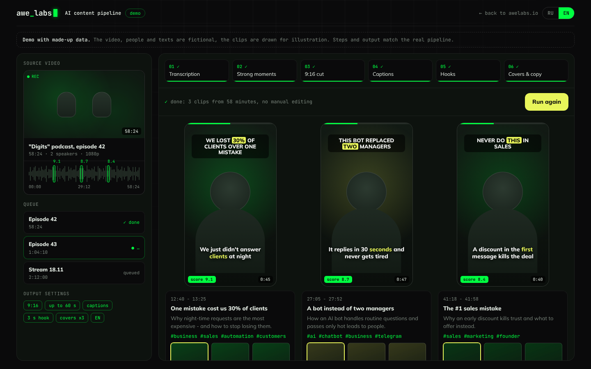
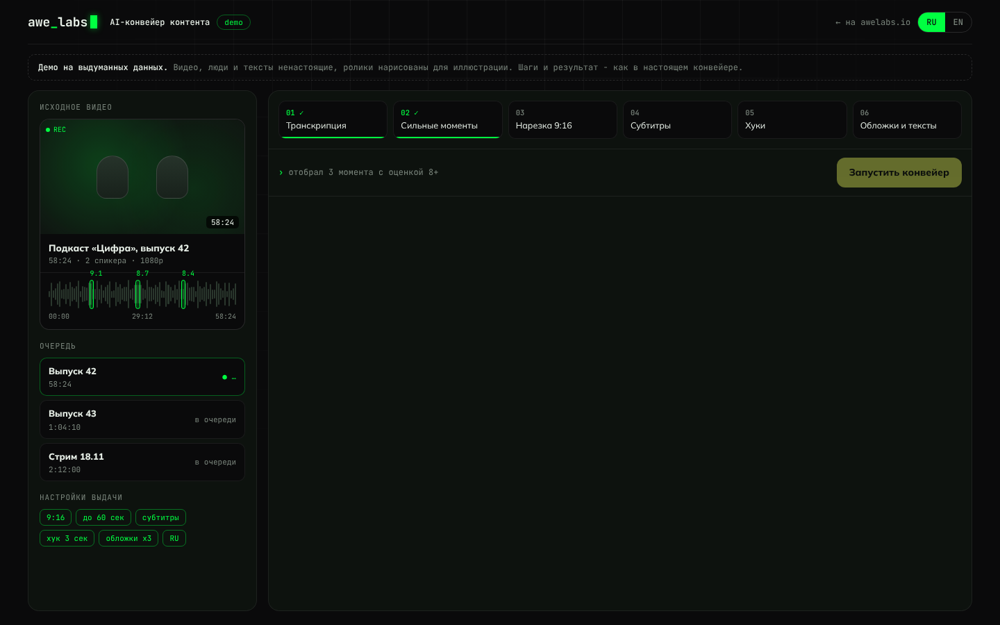

# AweLabs - AI content pipeline (demo)

**Live demo:** https://awelabs.io/demo/content/

[English](#english) · [Русский](#русский)

## English

A front-end demo of a pipeline that turns long videos (podcasts, streams, interviews) into ready short clips for Reels, Shorts and TikTok - without manual editing.

> **Demo with made-up data.** The video, people and texts are fictional; the clips are drawn for illustration. Steps and output match the real pipeline.

### What the real pipeline does
- **Transcribes** the whole video with speaker separation.
- **Finds the strongest moments** and scores each candidate for retention.
- **Cuts 9:16** clips up to 60 seconds and keeps the speaker's face in frame.
- **Word-level captions** with key words highlighted.
- **Writes a hook** for the first 3 seconds.
- **AI covers, descriptions and hashtags** - 3 cover options per clip.
- **Batch processing:** drop a queue of videos and get clips for all of them.

### What the demo shows
Source video with the found moments on the timeline, a 6-step pipeline with live progress, and the result: 3 vertical clips with hooks, animated captions, scores, covers, descriptions and hashtags. Queue of the next videos on the left. RU / EN.

One static `index.html`, no build, no backend.

---

## Русский

Фронт-демо конвейера, который превращает длинное видео (подкаст, стрим, интервью) в готовые короткие ролики для Reels, Shorts и TikTok - без ручного монтажа.

> **Демо на выдуманных данных.** Видео, люди и тексты ненастоящие, ролики нарисованы для иллюстрации. Шаги и результат - как в настоящем конвейере.

### Что умеет настоящий конвейер
- **Расшифровывает** всё видео с разделением спикеров.
- **Находит сильные моменты** и оценивает каждый кандидат на удержание.
- **Режет 9:16** ролики до 60 секунд и держит лицо говорящего в кадре.
- **Субтитры по словам** с подсветкой ключевых слов.
- **Пишет хук** на первые 3 секунды.
- **Обложки, описания и хештеги делает AI** - 3 варианта обложки на ролик.
- **Пакетная обработка:** ставите очередь видео - получаете ролики по всем.

### Что показывает демо
Исходное видео с найденными моментами на таймлайне, конвейер из 6 шагов с живым прогрессом и результат: 3 вертикальных ролика с хуками, бегущими субтитрами, оценкой, обложками, описаниями и хештегами. Слева очередь следующих видео. RU / EN.

Один статичный `index.html`, без сборки и бэкенда.

---

**AweLabs** - automation studio · [awelabs.io](https://awelabs.io) · [t.me/awe_labs](https://t.me/awe_labs)
